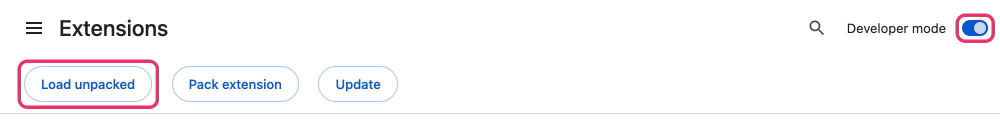
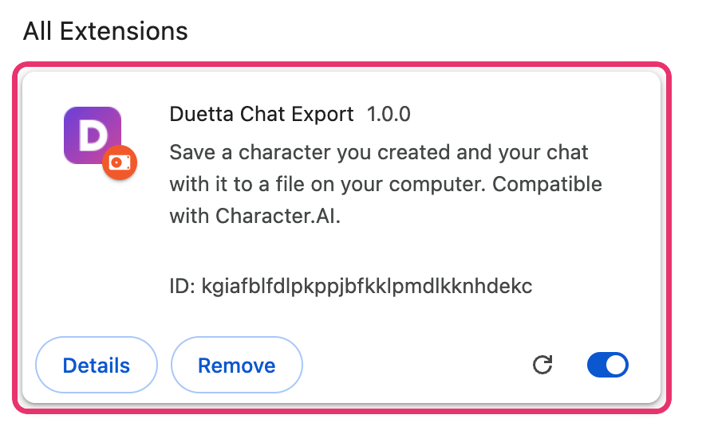
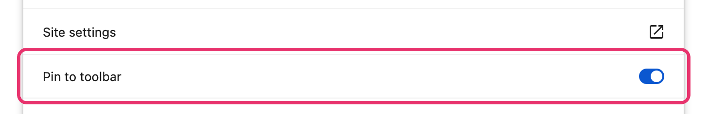
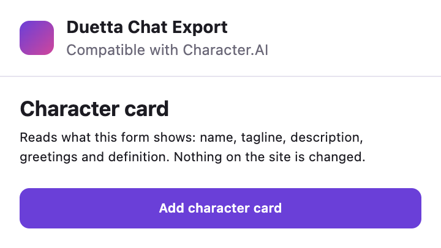
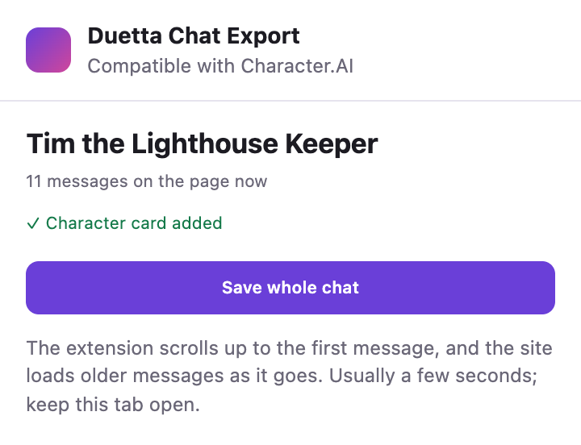
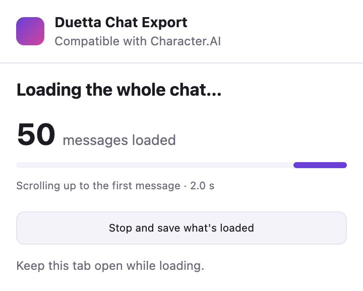
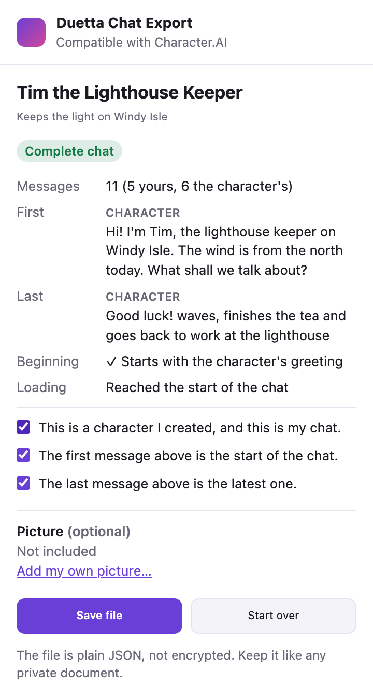
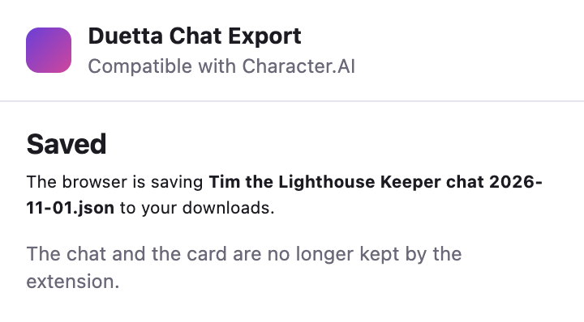

# Duetta Chat Export

Save a character you created on Character.AI, and your chat with it, to a file on your computer.
It is a Chrome extension: it reads only the tab you click it on and sends nothing anywhere. Not affiliated with Character.AI.

## Install in 3 minutes

You need Google Chrome on a computer. No account, no terminal.

1. **Download** [duetta-chat-export.zip](https://github.com/Duetta-ai/character-ai-chat-export/releases/latest/download/duetta-chat-export.zip). It is the file attached to the [latest release](https://github.com/Duetta-ai/character-ai-chat-export/releases/latest).

2. **Unzip it.** On a Mac, double-click the file. On Windows, right-click it and choose **Extract All**. You get a folder named `duetta-chat-export`. Leave it where it is: Chrome runs the extension from this folder.

3. **Open the extensions page.** Type `chrome://extensions` in the address bar and press Enter. Turn on **Developer mode** in the top right corner.

   

4. **Click Load unpacked** (top left) and choose the `duetta-chat-export` folder. The extension appears on the page:

   

   If Chrome says "Manifest file is missing or unreadable", you chose another folder: choose the one with `manifest.json` inside.

5. **Pin it to the toolbar.** Click **Details** on the card and turn on **Pin to toolbar**. The purple **D** icon appears next to the address bar. (Or click the puzzle-piece icon next to the address bar, then the pin next to Duetta Chat Export.)

   

**Update to a new version:** click **Remove** on the card at `chrome://extensions`, then install the new zip the same way.

## How to export

Sign in to character.ai as usual. The extension works only with characters you created.

1. **Add the character card.** Open your character's **Edit** page, click the **D** icon and press **Add character card**. The extension saves what the form shows: name, tagline, description, greetings and definition.

   

2. **Save the chat.** Open your chat with this character, click the **D** icon and press **Save whole chat**.

   

   The extension scrolls up to the first message while the site loads older ones. Keep the tab open: it usually takes a few seconds, longer for a long chat. You can press **Stop and save what's loaded** at any time.

   

3. **Check and save.** The preview shows how many messages there are, the first and the last one, and whether the chat is complete. Tick **This is a character I created, and this is my chat**, check the other two boxes and press **Save file**. You can also add your own picture to the file (optional).

   

4. **Done.** The file `<character name> chat <date>.json` is in your Downloads folder. The extension forgets the chat as soon as the file is saved.

   

The card can be added before or after saving the chat; the popup reminds you if it is missing. If the popup says it can't read a message or can't tell who wrote it, the site has changed and the extension needs an update: please [open an issue](https://github.com/Duetta-ai/character-ai-chat-export/issues).

## For developers

The file uses Duetta's own format (v1), described by a JSON Schema in [`contracts/`](contracts/cai-export-v1.schema.json). It is meant for importing the character and the chat into Duetta, and it is plain JSON that anyone can read.

### What it does

1. On your character's **Edit** page, click the extension and **Add character card**. It reads what the form shows: name, tagline, description, greetings and definition.
2. Open your chat with that character, click the extension and **Save whole chat**. The extension scrolls the chat up to the first message; the site loads older messages as the list reaches the top, the same way it does when you scroll by hand. You see how many messages are loaded and can **Stop and save what's loaded** at any time.
3. The extension then reads the messages on the page once and shows a preview: the character, the number of messages, the first and the last message, whether the chat starts with the character's greeting, and whether the chat is complete.
4. You confirm that the character and the chat are yours, and whether the first and last messages are the real start and end. Optionally add your own picture from a file on your computer. **Save file** downloads the JSON.

Only you start it, by clicking. It works on your own characters only: the chat header must say "By @you" with the handle of the account you are signed in with, and the page must have the character's Edit link.

### What is saved

- The character card, as the edit form shows it. A field the form does not show is saved as `null`, never guessed.
- One chat: every message from the first loaded one to the newest, in order, with who wrote it (you or the character) and the text as displayed, including line breaks and emoji. Identical messages stay separate.
- Only the reply variant that is shown. Variants you swiped away are not saved.
- A picture only if you choose an image file (PNG, JPEG or WebP, up to 2 MB and 16 megapixels).
- How complete the chat is: whether loading reached the greeting, why it stopped, and what you confirmed.

### What is not saved

- Other people's characters, other chats, other branches, swiped-away replies.
- Message dates and ids: the page does not show them. The chat id is saved only if you opened the chat from **History** (its address then has `?hist=`).
- Formatting marks: `*italics*` and `**bold**` are saved as the plain text you see.
- Pictures, audio or video inside chat messages: the extension stops with an error instead of saving such a message without them. Also voice settings, hidden settings and the character's picture from the site.
- Anything outside the page: the extension has no access to your account, cookies or the site's storage, and sends nothing anywhere.

### Privacy and permissions

| Permission | Why |
|---|---|
| `activeTab` | Read the open tab only after you click the extension icon. |
| `scripting` | Run the page reader in that tab. |
| `storage` | Keep the card and the chat in memory between popup openings (`chrome.storage.session`). It is cleared when you save, when you press Start over and when the browser closes. |

There are no host permissions, no content scripts that run by themselves, no background worker, no analytics and no remote code. The extension makes **no network requests**: the popup's Content Security Policy has `connect-src 'none'`, and the reader only reads the page and scrolls it. Older messages are loaded by the site's own page, as when you scroll by hand. The file is downloaded from a local Blob, so the `downloads` permission is not needed.

The saved file is plain, unencrypted JSON. Keep it like any private document. The privacy policy is in [PRIVACY.md](PRIVACY.md).

### Install from source (unpacked)

1. Download or clone this repository.
2. Open `chrome://extensions` and turn on **Developer mode**.
3. Click **Load unpacked** and select the `extension` folder.
4. Pin the extension to the toolbar.

There is no build step: the `extension` folder is exactly what Chrome runs. After you update the files, press **Reload** on the extension card and reload the site's tab.

### Release

1. Raise the version in `extension/manifest.json`, `extension/export.js` (`PRODUCER`, written into every file) and `package.json`; `npm test` checks that the manifest and the file agree. Then run `UPDATE_GOLDEN=1 npm test` and review the diff.
2. `scripts/package.sh` packs `extension/` into `dist/duetta-chat-export.zip` with `manifest.json` at the root of the zip.
3. `gh release create vX.Y.Z dist/duetta-chat-export.zip`. Keep the file name: the download link above always points to the latest release's `duetta-chat-export.zip`.
4. The same zip goes to the Chrome Web Store; the listing texts, pictures and the submission checklist are in [`store/`](store/).

### Limitations

- **The site's page layout.** The reader relies on how the chat page is built today: a list with the newest message first, the author of each message shown by the row, one text block per message. When the layout changes, it stops with "Can't read a message", "Can't tell who wrote a message" or "Can't tell the order of messages" instead of guessing, and the extension needs an update. The reader version is written into every file (`producer.reader_version`).
- **Start of the chat.** The page has no explicit "start" mark for long chats. The extension stops when the oldest message equals one of the character's greetings (`{{user}}` and `{{char}}` are accounted for), when the site shows its start-of-chat card, or when no older messages arrive twice in a row. A chat that starts with an AI-written greeting will not match; you confirm the start yourself.
- **Keep the tab open** while it loads. A background tab is throttled by the browser; the extension waits instead of giving up.
- **Size.** One file holds up to 5,000 messages and 5 MB; a single message up to 32 KB. If a chat is longer, loading stops once older messages can no longer fit, the newest messages that fit are saved, the file is marked partial and the preview says how many older messages were left out. Text is never cut, and a history longer than one file is never read in full.
- **Ownership** is checked by what the page shows and confirmed by you. It is not a cryptographic proof.
- Not tested yet: chats of thousands of messages, Persona names, edited messages, mobile layouts.

### The file

See [`contracts/cai-export-v1.schema.json`](contracts/cai-export-v1.schema.json) and the examples in [`fixtures/golden`](fixtures/golden). In short:

- `character`: `source_character_id`, `name`, `tagline`, `description`, `greeting`, `alternate_greetings`, `definition`, `avatar` (`null` or a picture you chose, as base64).
- `chat.messages[]`: `index` (order), `role` (`user` or `assistant`), `text`; `source_message_id` and `source_created_at` are `null`.
- `chat.coverage`: `status` is `complete` only when you confirmed both the start and the end; `first_message_matches_greeting` is a hint, not a proof; `stopped_by` says why loading stopped.
- `warnings`: what is missing or unconfirmed, for example `CHAT_START_NOT_CONFIRMED`, `HISTORY_LIMIT_REACHED` or `SOURCE_TIMESTAMPS_UNAVAILABLE`.

Byte limits that JSON Schema cannot express (file size, UTF-8 bytes per message, image size) are checked by the extension and should be checked again by any importer.

### Development

```sh
npm ci
npx playwright install chromium
npm test
```

- `test/format.test.mjs`: the schema, the golden files and how the file is built (Node).
- `test/reader.test.mjs`: the page reader on fixture pages in headless Chromium: exact text, roles, order, scrolling, limits, ownership, unknown layouts.
- `test/golden.test.mjs`: fixture pages → file, compared with `fixtures/golden`. After an intended format change run `UPDATE_GOLDEN=1 npm test` and review the diff.
- `test/extension.test.mjs`: the real extension in headless Chromium, including the network log. `SHOTS=<folder> npm test` also saves screenshots of the popup and the log.

Fixture pages are served at `https://character.ai/...` only inside the test browser by request interception; tests never contact the real site. All fixtures use a made-up character with fake ids. The pictures in `docs/img` and `store/` are screenshots of the real extension on these fixture pages, with their texts put into English, and of `chrome://extensions` in Chrome.

### License

MIT — see [LICENSE](LICENSE). This project is not affiliated with or endorsed by Character.AI.
